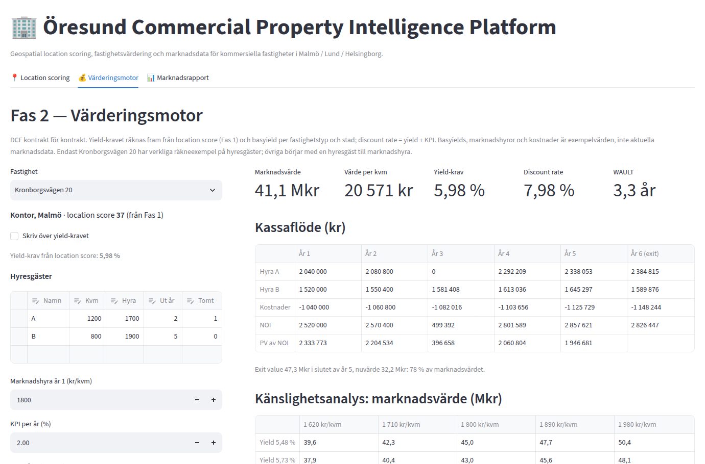
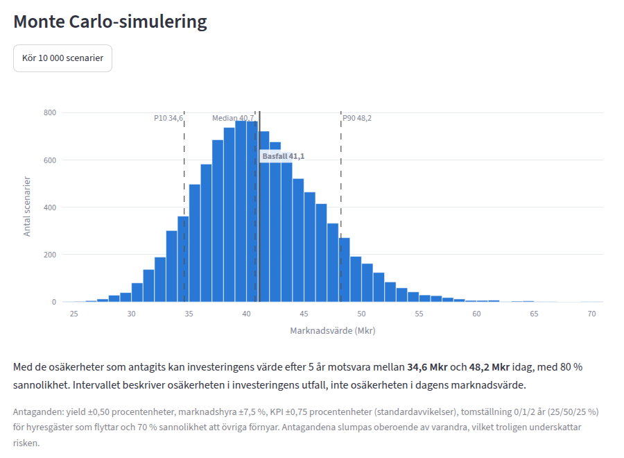

# Öresund Commercial Property Intelligence Platform

Analysverktyg för kommersiella fastigheter i Malmö, Lund och Helsingborg. Det följer arbetsflödet hos en analytiker på en fastighetsrådgivningsfirma: bedöm läget, värdera fastigheten enligt branschstandard och jämför antagandena med marknaden.

> **In English:** A Python tool for commercial real estate analysis in the Öresund region. It scores locations from open geodata, values properties with a lease-by-lease DCF (WAULT, reversion, void deductions, sensitivity analysis and Monte Carlo simulation), and calibrates its assumptions against market data from Newsec and Cushman & Wakefield. Built with pandas, Pydantic and Streamlit, covered by 73 automated tests.



## Status

| Fas | Innehåll | Status |
|---|---|---|
| 1 | Geospatial location scoring | ✅ Klar |
| 2 | Värderingsmotor (DCF kontrakt för kontrakt) | ✅ Klar |
| 3 | Marknadsdata, analys och PDF-rapport | 🔄 Pågår: marknadsdata insamlad, analys påbörjad |

## Fas 1: Location scoring

Varje fastighet får ett **location score** (0–100) som väger samman:

| Faktor | Mätning | Källa |
|---|---|---|
| Kollektivtrafik | Avstånd till närmaste tåg- eller spårvagnsstation, poängen halveras var 700 m | Egna koordinater |
| Motorväg | Avstånd till närmaste motorvägstrafikplats, poängen halveras var 2 000 m | Egna koordinater |
| Kommersiell täthet | Antal butiker, restauranger, caféer m.m. inom 500 m, med mättnadskurva | OpenStreetMap (Overpass API) |

Vikterna skiljer sig per fastighetstyp, eftersom olika hyresgäster värderar olika saker. Kontor väger kollektivtrafik tyngst, logistik motorvägen (80 %) och tätortshandel kundunderlaget. Resultatet visas på en interaktiv karta (Folium) och i en tabell.

## Fas 2: Värderingsmotor

Värderingen följer avkastningsmetoden som används för kommersiella fastigheter i Sverige.

- **DCF kontrakt för kontrakt.** Varje hyresgäst har egen area, kontraktshyra, löptid och tomställning. Hyran indexeras med KPI till kontraktets slut och går sedan över till marknadshyra.
- **WAULT**, viktad efter årshyra.
- **Over- och under-rented** hyresgäster, med reversion till marknadshyra.
- **Exit value** från stabiliserat NOI och exit yield, med avdrag för tomställning vid exit (void deduction).
- **Yield-kravet beror på läget.** Location score från Fas 1 översätts till ett påslag eller avdrag på basyielden med en asymmetrisk S-kurva: dåliga lägen straffas mer än bra lägen belönas. Discount rate = yield + KPI, så att modellen blir konsistent med Gordons formel.
- **Känslighetsmatris:** marknadsvärde vid yield ±0,50 procentenheter och marknadshyra ±10 %.
- **Monte Carlo-simulering** med 10 000 scenarier, där yield, marknadshyra, KPI, tomställning och omförhandling slumpas.

Varje beräkning gjordes först för hand i Excel, och de siffrorna används som tester i koden.



## Fas 3: Marknadsdata och rapport (pågår)

**Klart:**
- Datamodell och Excel-mall för marknadsdata, med validering av varje rad. Kontrollen fångar vanliga fel som procent skrivna som decimaltal eller månadshyra i stället för årshyra.
- 41 nyckeltal insamlade för kontor, butik, logistik och bostäder:
  - hyresnivåer per lägesklass (AA–C) i alla tre städerna från Newsec
  - prime yield, prime rent och vakans från Cushman & Wakefields MarketBeat Q2 2026

**Första resultat av analysen.** Jämförelsen med marknadsdata visar tre antaganden i Fas 2 som behöver kalibreras om:

1. Basyielden för tätortshandel (5,75 %) ligger under prime yield för butiker i Malmö (5,95 %). De bästa lägena värderas därför över marknadens topp.
2. Marknadshyran för logistik (900 kr/kvm) ligger över prime rent i Öresundsregionen (850 kr/kvm).
3. Marknadshyran borde bero på läget. Newsecs intervall för tätortshandel i Malmö går från 950 kr/kvm i C-läge till 6 300 kr/kvm i AA-läge.

**Kvar:**
- kalibrering av Fas 2 mot marknadsdatan
- insamling av kontorsannonser
- grafer
- PDF-rapporten "Öresund Commercial Property Market Snapshot"
- dashboard i appen

## Data och begränsningar

- **Fastigheterna är exempel.** Adresserna är riktiga, men hyresavtal, areor och kostnader är påhittade för att visa modellen. Nio av femton fastigheter har ungefärliga koordinater.
- **Marknadsdatan är verklig** och hämtad från publika källor. Källa och datum anges för varje siffra.
- **Arbetsplatsdata saknas.** SCB publicerar inte dagbefolkning per område som öppna data, så faktorn hoppas över och vikterna skalas om.
- Kända förbättringar finns i [docs/backlog.md](docs/backlog.md).

## Teknik

- **Python:** pandas, NumPy, Pydantic (datavalidering), openpyxl
- **Geodata:** OpenStreetMap via Overpass API, haversine-avstånd
- **Visualisering:** Folium, Plotly
- **App:** Streamlit
- **Tester:** pytest, 73 tester inklusive test av hela appen

## Projektstruktur

```
├── data/
│   ├── sample/                    # Exempelfastigheter, stationer, trafikplatser, OSM-räkningar
│   └── market/                    # Insamlad marknadsdata (Excel)
├── docs/
│   ├── plan.md                    # Fasplan
│   ├── backlog.md                 # Kända begränsningar och nästa steg
│   └── fas3_insamling.md          # Instruktioner för insamling av marknadsdata
├── src/
│   ├── phase1_location_scoring/   # Location score, karta, hämtning från OpenStreetMap
│   ├── phase2_valuation/          # DCF, yield-modell, känslighetsanalys, Monte Carlo
│   └── phase3_market_report/      # Marknadsdata: modeller, inläsning, kontroll
├── tests/
└── streamlit_app.py               # Appens startpunkt
```

## Kom igång

```bash
python -m venv .venv
.venv\Scripts\activate             # Windows. På macOS/Linux: source .venv/bin/activate
pip install -r requirements.txt
streamlit run streamlit_app.py
```

Kör testerna med `python -m pytest`.
